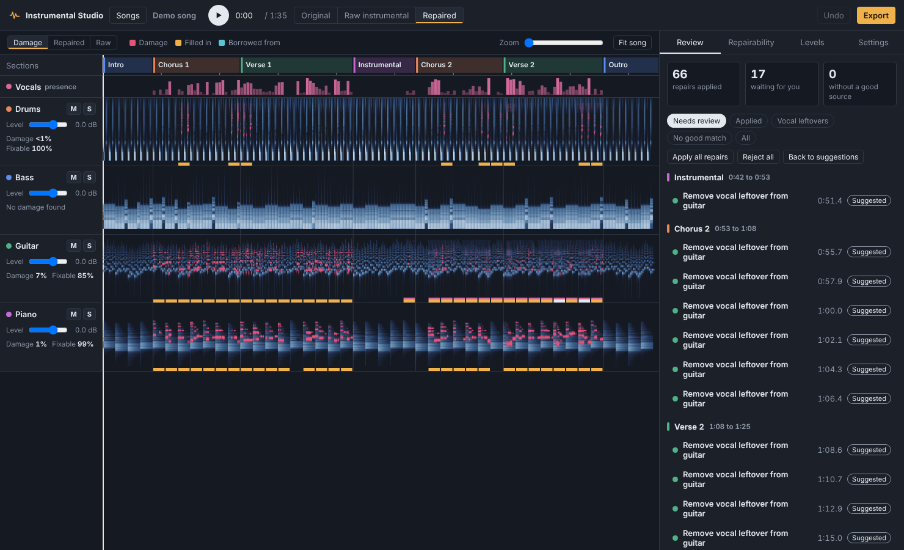
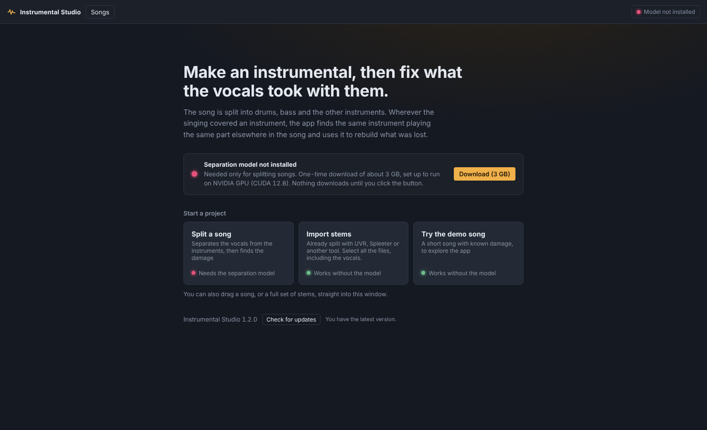
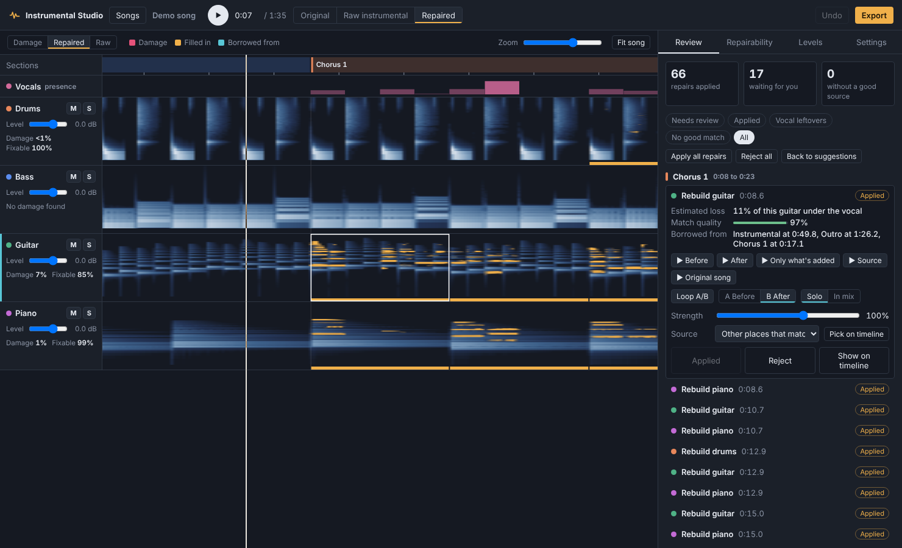
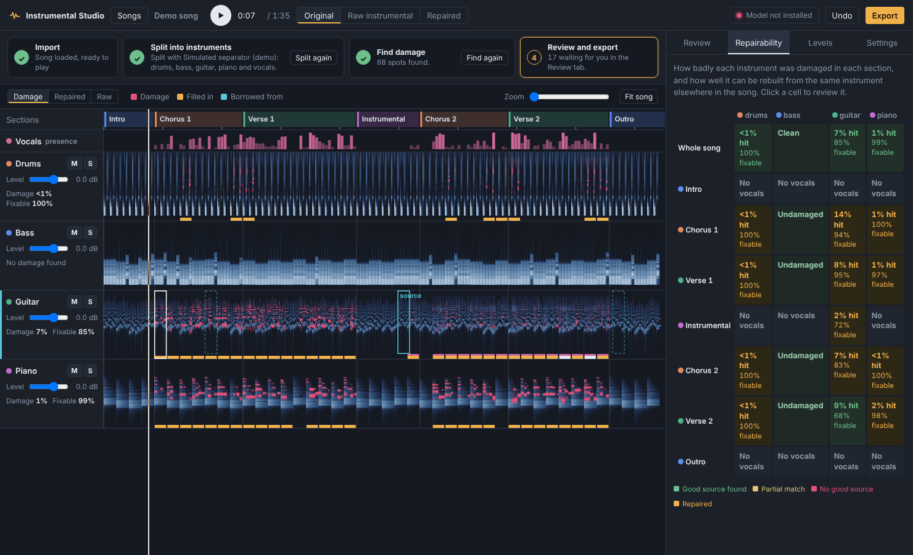
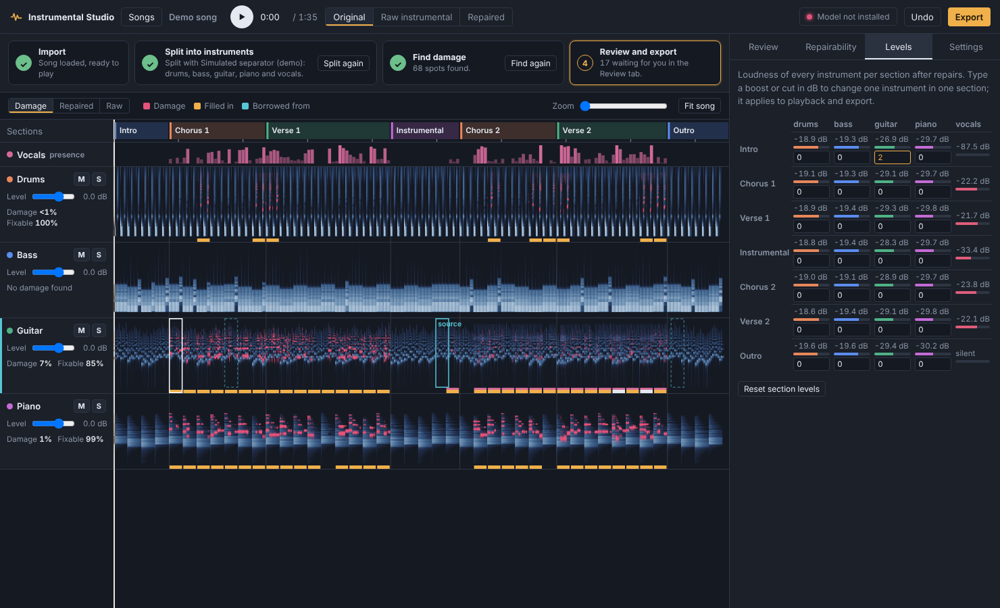
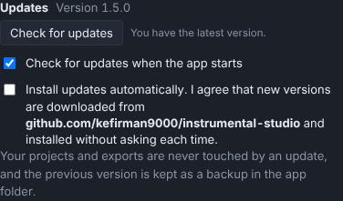

# Instrumental Studio

Make an instrumental version of any song, then fix the parts that got damaged when the vocals were taken out.



When you remove the vocals from a song, the instruments playing underneath the singing usually get damaged too: a guitar goes thin, a piano chord loses its middle, a cymbal turns watery. Instrumental Studio shows you exactly where that happened, then rebuilds those spots using the same instrument playing the same part somewhere else in the song, like the intro, a break, or a moment where the singer paused.

**[Download the latest version](https://github.com/kefirman9000/instrumental-studio/releases/latest)** · Windows, Mac and Linux · Free

## What you can do

- **Split a song** into drums, bass, other instruments and vocals, or use stems you already made with another tool.
- **See the damage** for every instrument on one timeline, marked in red.
- **Fix it automatically** from matching parts of the same song. Confident fixes are applied for you; uncertain ones wait for your OK.
- **Listen before deciding**: before and after, a looping A/B switch, only the sound that was added, or the place it was borrowed from.
- **Stay in control**: accept or reject any fix, make it weaker or stronger, or pick a different part of the song to borrow from.
- **See what's fixable** in every section, for every instrument, at a glance.
- **Balance the mix**: change the volume of any instrument, for the whole song or just one section.
- **Clean up leftover singing** that leaked into the instruments.
- **Export** the finished instrumental and each instrument separately as WAV, FLAC or MP3.

## Install

You do this once. It takes about 10 minutes, most of it waiting for downloads.


1. **Download the app.** Go to the [latest release](https://github.com/kefirman9000/instrumental-studio/releases/latest), download **InstrumentalStudio-x.x.x.zip**, and unzip it somewhere you'll find it again, such as your Documents folder.

2. **Install Python** (version 3.10 or newer) from [python.org/downloads](https://www.python.org/downloads/).
   - On Windows, tick **Add Python to PATH** on the first screen of the installer.
   - On a Mac, afterwards open your Applications → Python folder and double-click **Install Certificates.command**.

3. **Install ffmpeg**, which lets the app read MP3 and M4A files. Open a terminal (on Windows: Start menu → type *Terminal*) and run the line for your computer:
   - Windows: `winget install ffmpeg`
   - Mac: `brew install ffmpeg` (needs [Homebrew](https://brew.sh))
   - Linux: `sudo apt install ffmpeg`

4. **Install the app's parts.** In the terminal, go into the unzipped folder and run:
   ```
   pip install -r requirements.txt
   ```

5. **Start it.**
   - Windows: double-click **Start Instrumental Studio (Windows).bat**
   - Mac: double-click **Start Instrumental Studio (Mac).command**. The first time, macOS may block it: right-click it, choose **Open**, then **Open** again.
   - Linux: run `./start.sh` in the terminal

The app opens in its own window.

### The separation model

Splitting songs uses Demucs, a free model that runs on your own computer. It isn't included in the download, and the app never downloads it without asking.

The start screen has a **Separation model** panel with a status light:

- 🔴 **Not installed**: click **Download** to get it. The button shows how big it is (about 3 GB with an NVIDIA graphics card, less without). The app picks the right version for your computer: NVIDIA graphics cards and Apple silicon Macs are used automatically for much faster splitting.
- 🟡 **Downloading**: shows progress. You can import stems or try the demo meanwhile.
- 🟢 **Ready**: you can split songs.

The same light is always in the top-right corner of the window. You only need the model for **Split a song**; **Import stems** and the demo work without it.

## Your first song



1. Make sure the separation model light is green (see above).
2. Click **Split a song** and choose a file, or just drag the song into the window. Splitting takes under a minute with a graphics card, or a few minutes without one.
   - Already have stems from another tool? Click **Import stems** and select all of them, or drag them all in at once. One of them must have *vocals* in its name.
3. When it's done, every instrument appears on the timeline. **Red** marks show where the vocals damaged that instrument.
4. Press **Space** to play. Switch between **Original**, **Raw instrumental** and **Repaired** at the top to compare.
5. Fixes the app is confident about are already applied. Open the **Review** tab to check the ones waiting for you.
6. Click **Export** when you're happy.

Not ready to open your own song? Click **Try the demo song** to explore everything first. It works without the separation model.

## A quick tour

### Review each fix



Click any mark on the timeline, or any item in the **Review** list, to see:

- **Estimated loss**: how much of the instrument the vocals took at that spot.
- **Match quality**: how closely the borrowed part matches. Higher is safer.
- **Borrowed from**: which parts of the song were used to rebuild it.

Then listen with **Before**, **After**, **Only what's added**, **Source** or **Original song**. **Loop A/B** plays the before and after versions together so you can flip between them instantly with the A and B keys. Choose **Solo** to hear just that instrument, or **In mix** to hear it with everything else.

If a fix doesn't sound right, turn down its **Strength**, choose another place to borrow from under **Source**, or click **Pick on timeline** and click anywhere in that instrument's lane. Or simply **Reject** it.

Switch the timeline to **Repaired** view to see the sound that was filled back in, shown in amber.

### See what's fixable



The **Repairability** tab shows every section of the song against every instrument. Green means a good match was found elsewhere in the song, yellow means a partial match, red means nothing similar exists to borrow from, and amber means it's already repaired. Click any square to review just that part. Double-click a section name to rename it.

### Balance the levels



The **Levels** tab shows how loud every instrument is in every section. Type a number of decibels into any box to turn that instrument up or down in just that section; for example, `2` to lift the guitar in the chorus. Each instrument's lane also has its own volume slider, plus **M** (mute) and **S** (solo).

### Keyboard shortcuts

| Key | What it does |
|---|---|
| Space | Play or pause |
| J / K | Next / previous fix in the list |
| Enter | Apply the selected fix |
| Delete | Reject the selected fix |
| A / B | Hear before / after while looping |
| Ctrl + Z | Undo |
| Ctrl + scroll | Zoom the timeline |
| Shift + scroll | Move along the timeline |
| Esc | Stop the preview |

## Updates



Click **Check for updates** at the bottom of the start screen, or in **Settings**. If a new version exists, you'll see what changed and an **Install update** button. The app restarts when it's done. An update button also appears in the top bar whenever one is ready.

Tick **Install updates automatically** if you'd like new versions to install by themselves when the app starts.

Updates never touch your songs, projects or exports. The previous version is kept in a `.backup` folder inside the app folder, just in case.

## Good to know

- **A fix needs something to copy from.** Repairs work because songs repeat. If an instrument plays something under the vocals that never happens anywhere else, such as a one-time solo, the app marks it red and leaves it alone.
- **Listen to anything marked "Needs review".** Occasionally the borrowed part includes a note or fill that wasn't in the original spot. **Only what's added** makes that easy to hear.
- **Section names are a best guess.** The app may call a verse a chorus. Rename them in the Repairability tab.
- **Where your files are:** projects are saved automatically in an *InstrumentalStudio* folder in your home folder, and exports go to *InstrumentalStudio/exports*. **Settings → Show projects folder** opens it.

## Troubleshooting

**The model light is red after a download.** The panel says what went wrong. Click **Try again**, or Settings → **Reinstall separation model**. The message says what went wrong; most often it's the internet connection or not enough disk space (it needs about 3 GB). If it says your Python isn't supported, install Python 3.12 or 3.13 from python.org.

**MP3 files won't open.** ffmpeg is missing. Install it (step 3 above) and restart the app, or convert the song to WAV.

**Splitting is very slow.** Without a graphics card, a 4-minute song can take 5–10 minutes. Settings → *Separation for new songs* → **Fast** is quicker but a little less clean.

**"Can't verify GitHub's certificate" when checking for updates (Mac).** Open Applications → Python and double-click **Install Certificates.command**.

**The app opens in my web browser instead of its own window.** Run `pip install pywebview`, then start the app again.

---

## For developers

### How it works

1. Demucs splits the song into instrument stems and vocals.
2. The app finds the beat and bars, then divides the song into sections by where the harmony and texture change and which parts repeat.
3. Every beat of every instrument is described by its tone (40 frequency bands) and harmony (chroma), measured only in frequencies the vocal didn't cover.
4. For each bar that had vocals, it searches the song for bars where the same instrument plays the most similar part and was clear of vocals where this bar wasn't.
5. Damage is where the vocal was louder than the instruments and the instrument now has less energy than those matching bars say it should.
6. The missing sound is filled in from the matching bars: level-matched per frequency band, using the median of up to three sources, aligned to the beat, blended so the original sound is kept wherever it survived, and cross-faded at the edges.
7. Leftover vocal in an instrument is found by its spectrum moving in step with the vocal stem.

On the built-in demo, where the undamaged instruments are known, the piano's spectral error fell from 4.9 dB to 1.9 dB. The guitar, whose picking pattern changes every bar, improved less (7.0 to 6.0 dB). Run `python tests/test_engine.py` to repeat the test.

### Project layout

| Path | What's there |
|---|---|
| `app.py` | Starts the server and opens the window |
| `studio/` | Separation, analysis, repair, projects, local server, updater |
| `ui/` | The interface (HTML, CSS, JavaScript) |
| `tests/` | Engine test with a known answer, and an interface check |

You can also run it from a clone: `git clone https://github.com/kefirman9000/instrumental-studio.git`, then `pip install -r requirements.txt` and `python app.py`. Clones update with `git pull` when you click Install update.

### Releasing a new version

1. Raise `__version__` in `studio/__init__.py`.
2. Add a `## x.y.z` section at the top of `CHANGELOG.md` describing the changes in plain words.
3. Push to `main`.

A GitHub Action then publishes the release with a ready-to-download zip, using the changelog section as the release notes. Everyone's app finds it on their next update check.
