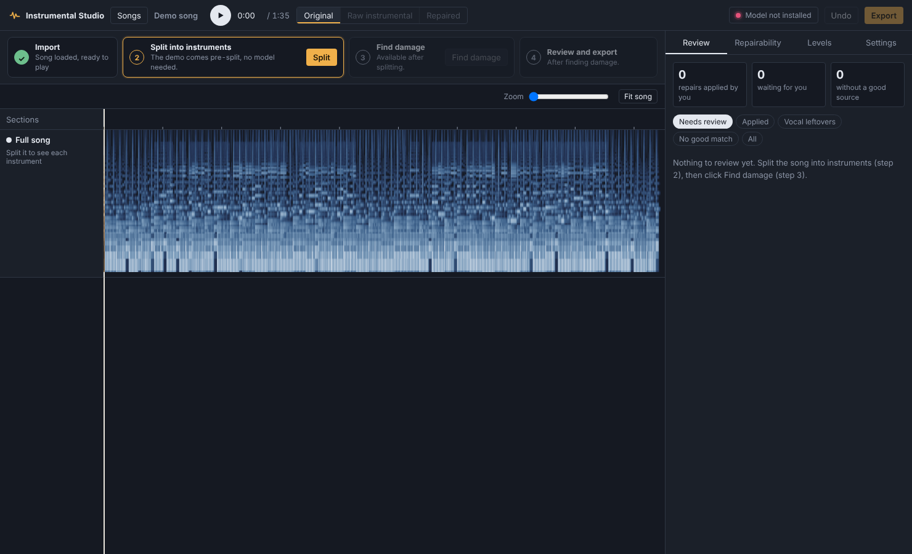
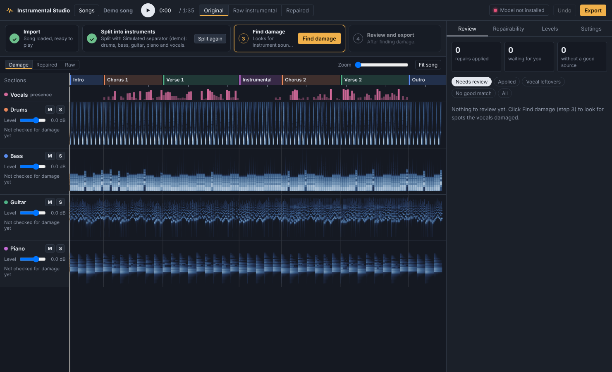
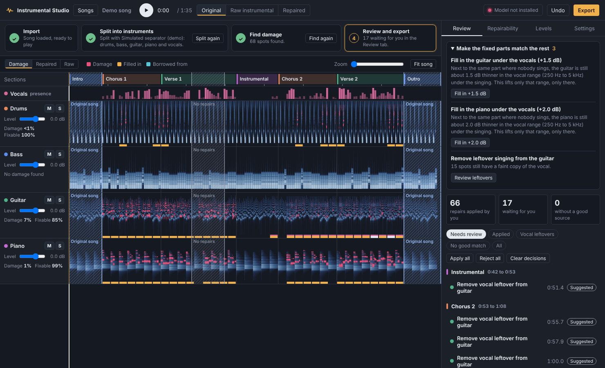

# Instrumental Studio

Make an instrumental version of any song, then fix the parts that got damaged when the vocals were taken out.


When you remove the vocals from a song, the instruments playing underneath the singing usually get damaged too: a guitar goes thin, a piano chord loses its middle, a cymbal turns watery. Instrumental Studio shows you exactly where that happened, then rebuilds those spots using the same instrument playing the same part somewhere else in the song, like the intro, a break, or a moment where the singer paused.

**[Download the latest version](https://github.com/kefirman9000/instrumental-studio/releases/latest)** · Windows, Mac and Linux · Free

## What you can do

- **Split a song** into drums, bass, other instruments and vocals, or use stems you already made with another tool.
- **See the damage** for every instrument on one timeline, marked in red.
- **Get suggested fixes** from matching parts of the same song. Nothing is applied until you say so; strong matches are marked Recommended.
- **Listen before deciding**: before and after, a looping A/B switch, only the sound that was added, or the place it was borrowed from.
- **Stay in control**: accept or reject any fix, make it weaker or stronger, or pick a different part of the song to borrow from.
- **See what's fixable** in every section, for every instrument, at a glance.
- **Balance the mix**: change the volume of any instrument, for the whole song or just one section.
- **Clean up leftover singing** that leaked into the instruments.
- **Keep any part as it is**, either the original recording or the split with no repairs.
- **Get tips** for making the fixed parts sound like the rest of the song.
- **Export** the finished instrumental and each instrument separately as WAV, FLAC or MP3.

## Install

You do this once. It takes about 10 minutes, most of it waiting for downloads.


1. **Download the app.** Go to the [latest release](https://github.com/kefirman9000/instrumental-studio/releases/latest), download **InstrumentalStudio-x.x.x.zip**, and unzip it somewhere you'll find it again, such as your Documents folder.

2. **Install Python** (version 3.10 or newer) from [python.org/downloads](https://www.python.org/downloads/).
   - On Windows, tick **Add Python to PATH** on the first screen of the installer.
   - On a Mac, afterwards open your Applications → Python folder and double-click **Install Certificates.command**.

3. **Install ffmpeg**, which lets the app read MP3 and M4A files. Open a terminal (on Windows: Start menu → type *Terminal*) and run the line for your computer:
   - Windows: `winget install ffmpeg`
   - Mac: `brew install ffmpeg` (needs [Homebrew](https://brew.sh))
   - Linux: `sudo apt install ffmpeg`

4. **Install the app's parts.** In the terminal, go into the unzipped folder and run:
   ```
   pip install -r requirements.txt
   ```

5. **Start it.**
   - Windows: double-click **Instrumental Studio.pyw** (no console window). **Start Instrumental Studio (Windows).bat** works too.
   - Mac: double-click **Start Instrumental Studio (Mac).command**. A Terminal window flashes up and closes; the app keeps running. The first time, macOS may block it: right-click it, choose **Open**, then **Open** again.
   - Linux: run `./start.sh` in the terminal

The app opens in its own window.

### The separation model

The **Split** step uses Demucs, a free model that runs on your own computer. It isn't included in the download, and the app never downloads it without asking.

The start screen has a **Separation model** panel with a status light:

- 🔴 **Not installed**: click **Download** to get it. The button shows how big it is (about 3 GB with an NVIDIA graphics card, less without). The app picks the right version for your computer: NVIDIA graphics cards and Apple silicon Macs are used automatically for much faster splitting.
- 🟡 **Downloading**: shows progress. You can import stems or try the demo meanwhile.
- 🟢 **Ready**: you can split songs.

The same light is always in the top-right corner of the window. You only need the model for the **Split** step. Opening songs, importing stems and the demo all work without it.

## Your first song


Click **Open a song** and choose a file, or just drag the song into the window. The song opens in the editor straight away and you can play it. Nothing is split or changed until you say so.



The steps across the top of the editor take you through the rest, one at a time, whenever you're ready:

1. **Import**: done. The song is saved in your projects.
2. **Split into instruments**: choose how and click **Split**. **4 tracks** gives drums, bass, other and vocals; **6 tracks** also separates guitar and piano, so damage is found and repaired for each of them on their own, which helps songs built on guitar or piano. With the optional extra models (below) you can also take the vocals out with Roformer first for the cleanest result, put backing vocals on their own track, and split the drums into kick, snare, toms and cymbals. Splitting needs the separation model; if it isn't installed yet, the button offers to download it. Takes under a minute with a graphics card, or a few minutes without one.
3. **Find damage**: click it when you want the app to look for spots the vocals damaged and suggest repairs. Nothing is applied yet: every repair waits for you, and the ones with a strong match are marked **Recommended**.
4. **Review and export**: listen, adjust, then click **Export**.



To start on another song, drag it onto the editor at any time: it opens as a new project, and the one you were working on stays saved in **Songs**.

After splitting you can already play, mute, solo and balance the instruments before looking for damage. You can also **Split again** with a different option, or **Find again** after changing your mind.

Already have stems from another tool? Click **Import stems** and select all of them, or drag them all in at once (one must have *vocals* in its name). They start at step 3. Want to try everything first? **Try the demo song** walks through every step and doesn't need the separation model.

## A quick tour

### Review each fix


Click any mark on the timeline, or any item in the **Review** list, to see:

- **Estimated loss**: how much of the instrument the vocals took at that spot.
- **Match quality**: how closely the borrowed part matches. Higher is safer.
- **Borrowed from**: which parts of the song were used to rebuild it.

First choose what to **Hear** (the choice is remembered):

- **All tracks**: every instrument, exactly as it sounds right now with your other repairs and levels. Before and after differ only by this one repair.
- **All tracks + vocals**: the same, with the singing on top, to judge the repair in the finished song.
- **Just the instrument**: only the instrument being repaired.

Then listen with **Before**, **After**, **Only what's added**, **Source** or **Original song**. **Loop A/B** plays before and after together so you can flip between them instantly with the A and B keys.

If a fix doesn't sound right, turn down its **Strength**, choose another place to borrow from under **Source**, or click **Pick on timeline** and click anywhere in that instrument's lane. Or simply **Reject** it.

Switch the timeline to **Repaired** view to see the sound that was filled back in, shown in amber.

### Extra models

The start screen's **Extra models** panel offers two optional downloads, each with its own status light. Nothing downloads until you click.

- **Roformer vocal models** (via the open-source [audio-separator](https://github.com/nomadkaraoke/python-audio-separator) package): adds the **cleanest vocal removal** split options, where a BS-Roformer model takes the vocals out before Demucs splits the instruments, and the **Backing vocals on their own track** option, which uses a karaoke model to separate backing vocals from the lead. Backing vocals then appear as their own lane you can keep, turn down or mute.
- **DrumSep** (via [mdxnet-infer](https://pypi.org/project/mdxnet-infer/)): the **Split drums into kick, snare, toms, cymbals** option.

### Try another model on one part

If one part still sounds rough, drag across it on the Sections bar and use **Try another model here**: pick a model and either all tracks or one instrument. The app splits the song with that model once (it's kept with the project, so trying it on other parts is instant), then adds that model's version of the part to Review under **Other takes**. Listen before and after with all tracks, then apply the ones that sound better. The suggestions also offer this for the part that lost the most.

### Rebuild repeated sounds from their cleanest copy

Songs repeat the same sounds over and over, so for nearly every damaged one there's a clean copy somewhere. The Repairability tab lists them:

- **Best hits**: the app finds each drum sound (kick, snare, hi-hat and cymbals, toms) and every time it's played, picks the cleanest hit, and fills in what the vocals took from each smeared one, lined up to the sample and matched to how hard it was played. Works on the drum track, or on the separate kick, snare, toms and cymbals tracks when you split the drums.
- **Repeated bars**: riffs and patterns an instrument plays again and again. Damaged repeats are replaced by the cleanest one, matched to the beat and level.

### Clean up a glitchy part

Drag across a part that sounds glitchy or artifacted and choose **Clean up this part**. In one go the app looks for clicks and gaps there, prepares smoothing for the watery separation sound under the vocals, and rebuilds damaged drum hits and repeated bars from their cleanest copies. Everything lands in Review for you to hear first; apply what helps, reject the rest. If it's beyond saving, the same menu can keep the original recording there, try another model, or mute it.

### Use the best version of repeating parts

When an instrument plays the same part more than once, the **Best versions** list (Repairability tab) offers its cleanest take for the other times, matched bar by bar to the beat and level, so the part sounds the same throughout. You can pick a different take from the list, and each one goes to Review first.

### Keep parts as they are



Drag across the **Sections** bar above the timeline to select a part of the song, then choose:

- **Use the original song here**: that part plays exactly as the original recording. Ideal for intros, outros and breaks with no singing, where the original already is a perfect instrumental. If there's singing in the part you selected, the app warns you that the vocals would stay.
- **Keep the split, no repairs**: that part stays as the separated instrumental, with no repairs and no level changes.

Kept parts are hatched on the timeline and listed in the **Levels** tab, where you can switch their kind or remove them. Undo works too.

### Clean up glitches and artifacts

- **Clicks and gaps**: after **Find damage**, the app listens to every instrument for short clicks, pops and sudden dropouts that don't belong, and lists them under **Clicks and smoothing** in the Review tab. It ignores drum hits, note starts and the natural rests in a part. Each fix smooths over just a few milliseconds.
- **Watery sound**: separation can leave a warbling, watery sound under the vocals. Drag across that part of the Sections bar and choose **Smooth watery sound here**. You get one fix per instrument and bar to listen to before applying.
- **Mute**: drag across a part and choose **Mute**, either **Everything** or one instrument, or click **M** next to an instrument in a section in the Levels tab. Muted parts are listed in the Levels tab. If an instrument is mostly leftover singing in a section, the suggestions offer to mute it there.

### Make the fixed parts match the rest

The top of the **Review** tab lists suggestions for keeping the repaired parts high quality and consistent with the rest of the song, each with a one-click button you can undo:

- **Use the original recording in the parts without singing**: the cleanest possible sound where there are no vocals.
- **Apply the recommended repairs**: the ones with a close match elsewhere in the song.
- **Fill in an instrument under the vocals**: once repairs are in, the app compares each instrument under the singing with the same part where nobody sings. If it's still thinner in the vocal range, it suggests lifting just that range, just under the vocals, by the measured amount.
- **Remove leftover singing** that stayed in an instrument.
- **Spots with no close match**: pick a source by hand or leave them alone.
- **Split again with Best quality** when fast separation left a lot to repair.

### See what's fixable


The **Repairability** tab shows every section of the song against every instrument. Green means a good match was found elsewhere in the song, yellow means a partial match, red means nothing similar exists to borrow from, and amber means it's already repaired. Click any square to review just that part. Double-click a section name to rename it.

### Balance the levels


The **Levels** tab shows how loud every instrument is in every section. Type a number of decibels into any box to turn that instrument up or down in just that section; for example, `2` to lift the guitar in the chorus. Each instrument's lane also has its own volume slider, plus **M** (mute) and **S** (solo).

### Keyboard shortcuts

| Key | What it does |
|---|---|
| Space | Play or pause |
| J / K | Next / previous fix in the list |
| Enter | Apply the selected fix |
| Delete | Reject the selected fix |
| A / B | Hear before / after while looping |
| Ctrl + Z | Undo |
| Ctrl + scroll | Zoom the timeline |
| Shift + scroll | Move along the timeline |
| Esc | Stop the preview |

## Updates


Click **Check for updates** at the bottom of the start screen, or in **Settings**. If a new version exists, you'll see what changed and an **Install update** button. The app restarts when it's done. An update button also appears in the top bar whenever one is ready.

Tick **Install updates automatically** if you'd like new versions to install by themselves when the app starts.

Updates never touch your songs, projects or exports. The previous version is kept in a `.backup` folder inside the app folder, just in case.

## Good to know

- **A fix needs something to copy from.** Repairs work because songs repeat. If an instrument plays something under the vocals that never happens anywhere else, such as a one-time solo, the app marks it red and leaves it alone.
- **Listen to anything marked "Needs review".** Occasionally the borrowed part includes a note or fill that wasn't in the original spot. **Only what's added** makes that easy to hear.
- **Section names are a best guess.** The app may call a verse a chorus. Rename them in the Repairability tab.
- **Where your files are:** projects are saved automatically in an *InstrumentalStudio* folder in your home folder, and exports go to *InstrumentalStudio/exports*. **Settings → Show projects folder** opens it.

## Troubleshooting

**The model light is red after a download.** The panel says what went wrong. Click **Try again**, or Settings → **Reinstall separation model**. The message says what went wrong; most often it's the internet connection or not enough disk space (it needs about 3 GB). If it says your Python isn't supported, install Python 3.12 or 3.13 from python.org.

**MP3 files won't open.** ffmpeg is missing. Install it (step 3 above) and restart the app, or convert the song to WAV.

**Splitting is very slow.** Without a graphics card the app starts you on **Fast** separation, which takes a few minutes per song. **Best quality** runs four models in a row and can take 5–15 minutes on a CPU; change it in Settings → *Separation for new songs*. Re-opening a song you've split before is instant: the app reuses the earlier split.

**"Can't verify GitHub's certificate" when checking for updates (Mac).** Open Applications → Python and double-click **Install Certificates.command**.

**Something went wrong and there's no console to read.** The app writes its messages to *app.log* in the InstrumentalStudio folder in your home folder.

**The app opens in my web browser instead of its own window.** Run `pip install pywebview`, then start the app again.

---

## For developers

### How it works

1. Demucs splits the song into instrument stems and vocals.
2. The app finds the beat and bars, then divides the song into sections by where the harmony and texture change and which parts repeat.
3. Every beat of every instrument is described by its tone (40 frequency bands) and harmony (chroma), measured only in frequencies the vocal didn't cover.
4. For each bar that had vocals, it searches the song for bars where the same instrument plays the most similar part and was clear of vocals where this bar wasn't.
5. Damage is where the vocal was louder than the instruments and the instrument now has less energy than those matching bars say it should.
6. The missing sound is filled in from the matching bars: level-matched per frequency band, using the median of up to three sources, aligned to the beat, blended so the original sound is kept wherever it survived, and cross-faded at the edges.
7. Leftover vocal in an instrument is found by its spectrum moving in step with the vocal stem.

On the built-in demo, where the undamaged instruments are known, the piano's spectral error fell from 4.9 dB to 1.9 dB. The guitar, whose picking pattern changes every bar, improved less (7.0 to 6.0 dB). Run `python tests/test_engine.py` to repeat the test.

### Project layout

| Path | What's there |
|---|---|
| `app.py` | Starts the server and opens the window |
| `studio/` | Separation, analysis, repair, projects, local server, updater |
| `ui/` | The interface (HTML, CSS, JavaScript) |
| `tests/` | Engine test with a known answer, and an interface check |

You can also run it from a clone: `git clone https://github.com/kefirman9000/instrumental-studio.git`, then `pip install -r requirements.txt` and `python app.py`. Clones update with `git pull` when you click Install update.

### Releasing a new version

1. Raise `__version__` in `studio/__init__.py`.
2. Add a `## x.y.z` section at the top of `CHANGELOG.md` describing the changes in plain words.
3. Push to `main`.

A GitHub Action then publishes the release with a ready-to-download zip, using the changelog section as the release notes. Everyone's app finds it on their next update check.
